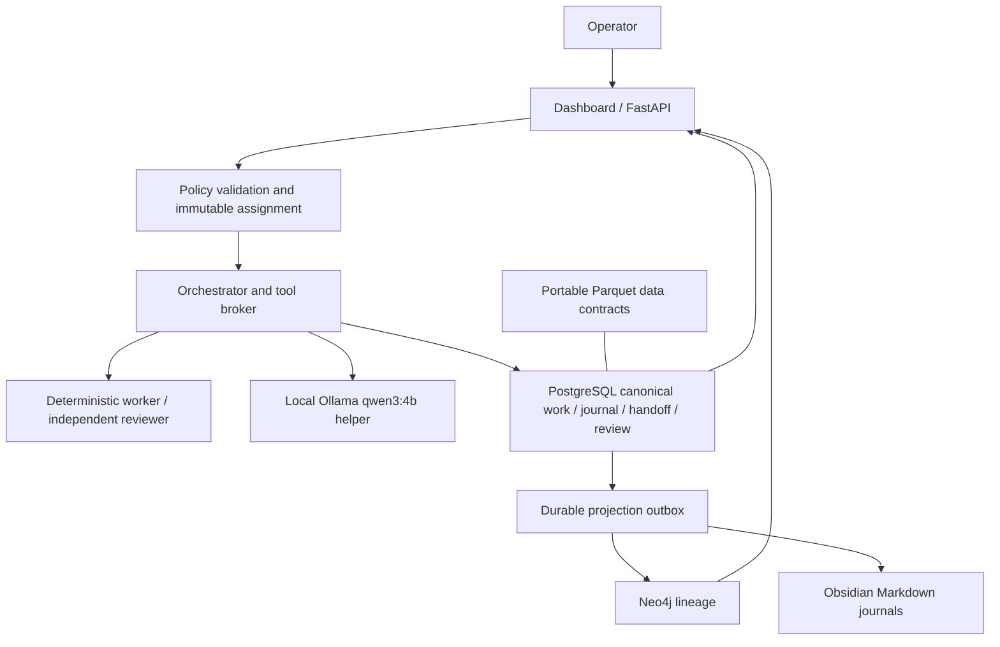

# Architecture

Triad is a local, bounded development/research work system. Day 2 adds functioning orchestration to the Day 1 data and knowledge foundation.

Providers return structured data. The host owns tools, state and authority. Policy evaluation precedes every execution; required independent review gates completion. Separate deterministic worker/reviewer implementations prove the full documentation-audit lifecycle. Real remote model adapters are unconfigured; their names in the demo are logical roles. Real local Qwen inference is observe-only and cannot review itself.

PostgreSQL/TimescaleDB share one container; Neo4j uses another. Named volumes retain database state. API and database ports bind loopback. Python runs in the project `.venv`. The frontend is served directly by FastAPI at port 8000. Mutation endpoints use an operator bearer token; read views remain local and unauthenticated.

Directory responsibilities: app Python/API/UI; agents registry; control-plane schemas and Day 1 intent contracts; data portable archival stages; infrastructure migrations; docs/vault human projection; research/generated bounded output; tests unit and live integration checks; tools setup/demo/recovery.

Atomic operational transactions include state events and projection outbox rows. Graph and Markdown are eventually consistent, retryable views. Exclusive filesystem artifacts are not transactionally atomic with PostgreSQL: interrupted runs require reconciliation. Background HTTP tasks are not a durable queue. See ORCHESTRATION.md and DAY2_SETUP.md for recovery and trust limits.

No broker, money movement, live trading, curated strategies or simulation engine is installed. General cloud agents, process isolation, durable scheduling, service accounts, backup recovery drills and provider authorization remain later architectural work. Day 1 setup reports remain historical evidence, not descriptions of current UI functionality.
