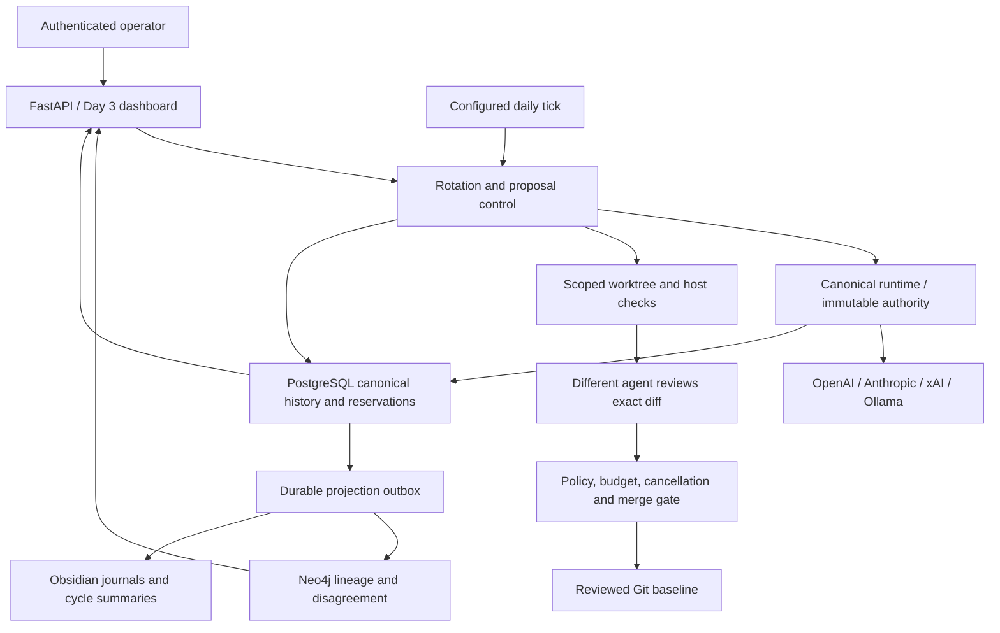

# Architecture

Triad is a local bounded development/research system. Day 3 extends the Day 2 WorkItem, policy, journal, handoff and provenance foundation with provider-independent improvement cycles.

Models return validated data; the host owns tools, state and authority. Real provider APIs and explicitly simulated fixture adapters share the same logical request contract. Cloud roles do not imply configured accounts. Qwen remains a Tier 0 support helper with controlled parent/depth routing. Current autonomous writes are nonexecuting documentation/research text; application-code and governance changes require separate human-reviewed development.

PostgreSQL/TimescaleDB and Neo4j run in persistent Docker volumes on loopback. Ollama serves qwen3:4b locally. Python runs from the project virtual environment; FastAPI serves UI/API on loopback port 8000. Mutations require a local operator bearer token; read views are unauthenticated on localhost. Credentials stay in environment/ignored .env and are excluded from provider context and persistence.

Operational transactions enqueue durable graph/Markdown projections. Git is not transactionally atomic with PostgreSQL; explicit checkpoints and blocked recovery preserve evidence. Scheduled/background tasks are not a durable queue. Kill serializes new dispatch/merge and invalidates in-flight authority, but cannot guarantee upstream HTTP computation stops. See AGENT_RUNTIME.md, KILL_SWITCH.md, SCHEDULER.md and ROLLBACK.md for exact limits.

No broker execution, live capital, strategy seeding or model self-training exists. Process sandboxing, service identities, backups/recovery drills and credentialed cloud validation remain deployment work. Day 1/2 reports describe their historical checkpoints; DAY3_VERIFICATION.md describes the current build.
