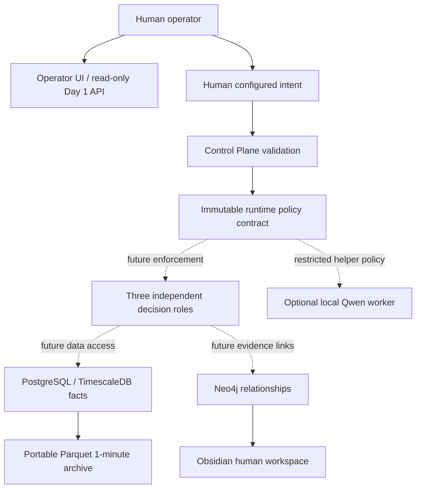

# Architecture

Draw the box first, then design how we interact with it.

Solid arrows describe ownership/data direction; dotted edges are planned interfaces,
not running agents. The API is read-only; neither policy deployment nor agent runtime
is implemented. No broker or execution adapter exists.

PostgreSQL and TimescaleDB share one container (TimescaleDB is a PostgreSQL extension).
Neo4j is separate. Persistent named volumes retain working state. Loopback bindings
isolate host access. Python is installed in a project-local virtual environment.

Directory responsibilities: `app` Python/API/UI; `agents` role boundaries;
`control-plane` contracts/examples; `data` archival stages and schemas;
`databases` ignored local exports; `infrastructure` service initialization;
`docs` architecture and human vault; `logs` local evidence; `research` open questions;
`tests` deterministic contract checks; `tools` reproducible setup and health checks.

Boundaries still required: authenticated human identity, sandboxed tool proxy,
audit persistence, service accounts, key management, backups, dataset ingestion,
calendar-aware aggregation and signed policy distribution. Day 1 does not pretend
those are implemented. No existing strategy corpus is imported.
